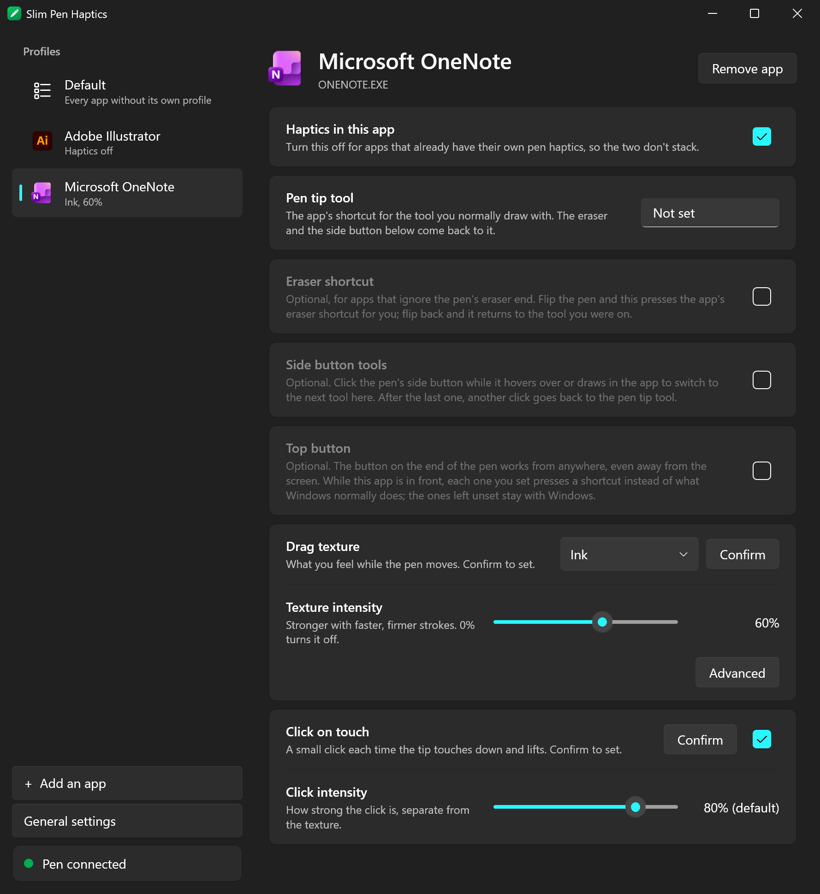
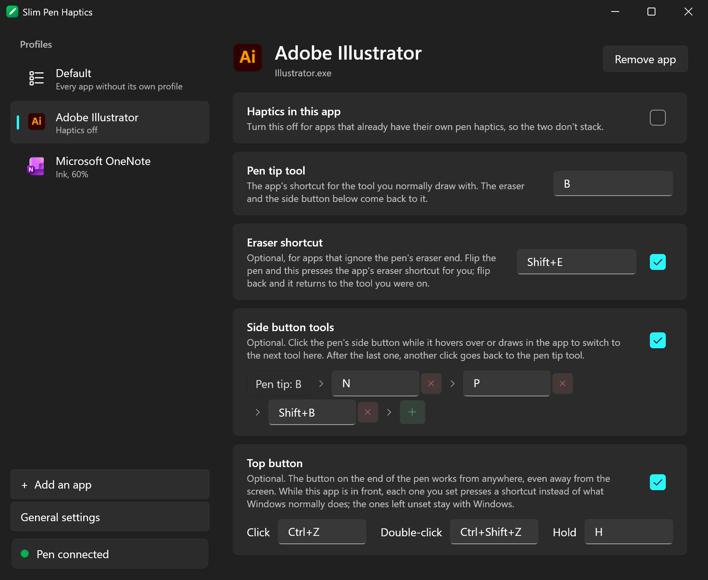
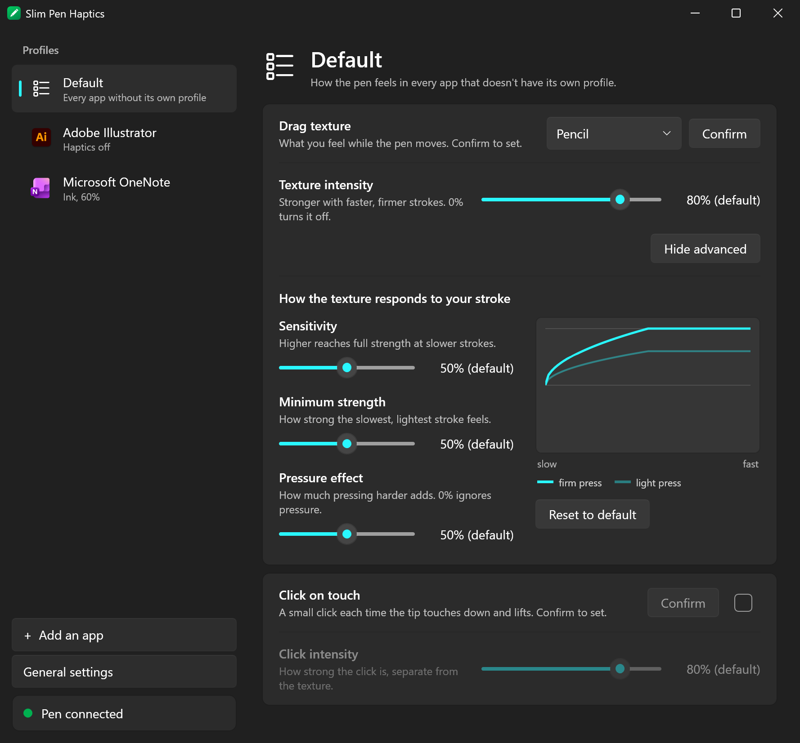
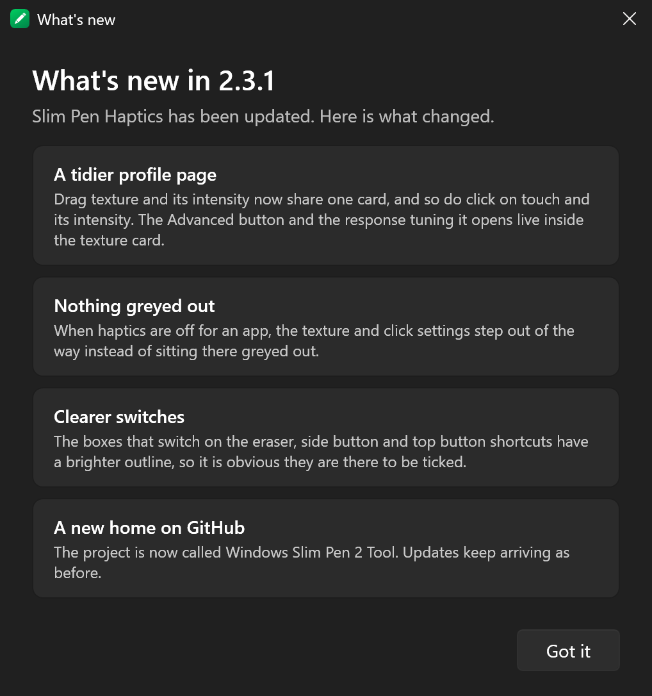

# Windows Slim Pen 2 Tool

**Surface Slim Pen 2 haptics only work in a handful of apps. This makes them work everywhere on Windows, and puts the pen's eraser end, side button and top button to work in any app.**

The Slim Pen 2 has a haptic motor that makes drawing feel like pen on paper, but Windows only lets approved apps use it. This tray app talks to the pen directly, so you get that feel in Clip Studio, Krita, OneNote, your browser, the desktop, or anything else. Each app can have its own feel. The pen's other controls can press an app's keyboard shortcuts for you: flip it to erase, click the side button to step through your tools, and use the top button from anywhere in the room.

<p align="center">
  
</p>

## What you get

- **Drag texture:** a continuous vibration while the pen moves, stronger with stroke speed and pressure, quiet when the pen rests. Choose Ink, Pencil, Marker or Brush, and press **Confirm** to feel it on the pen without drawing.
- **Per-app profiles:** give any app its own texture and intensity, or turn haptics off in apps that already have their own (so the two don't stack); the texture and click settings then step out of the way. The app switches automatically based on where you're drawing.
- **Response tuning:** under Advanced, set how sensitive the texture is to stroke speed, how strong the slowest stroke feels, and how much pressure adds, with a live graph of the result. Each profile has its own.
- **Pen tip tool:** tell each app's profile the shortcut of the tool you normally draw with, and the eraser and side button below know where to return to.
- **Eraser shortcut:** for apps that ignore the pen's eraser end, flipping the pen presses that app's eraser shortcut for you, and flipping back returns to the tool you were on. Optional, set per app, and switched on with a checkbox.
- **Side button tools:** click the pen's side button while it hovers over or draws in an app to switch to another tool by its shortcut. Add up to 10 tools with **+**; each click moves to the next, and after the last one it loops back to the pen tip tool. Optional, set per app.
- **Top button shortcuts:** the button on the end of the pen works over Bluetooth, so it reaches your PC from anywhere. Give its click, double-click and hold each a shortcut per app; while that app is in front the shortcut is pressed instead of what Windows has assigned. Optional, and gestures you leave unset stay with Windows.
- **Click on touch (optional):** a click when the tip touches down and lifts, with its own intensity slider. Off by default.
- **Intensity:** 0% to 100%, 80% by default, set separately for the texture and the click. Turn the Default profile down to 0% if you only want haptics in the apps you list.
- **Automatic updates** when installed, and it remembers your settings. After an update, a **What's new** window tells you what changed.
- A settings window in the Windows 11 style, with light and dark mode.

<p align="center">
  
</p>

<p align="center">
  
</p>

<p align="center">
  
</p>

<p align="center">
  
</p>

## Download and run

**[Download the installer](../../releases/latest/download/Install-SlimPenHaptics-Intel-AMD.exe)** for Intel and AMD Surfaces. This is the one most people want: it adds a Start menu entry and updates itself.

| Other downloads | For |
| --- | --- |
| [Install-SlimPenHaptics-Snapdragon.exe](../../releases/latest/download/Install-SlimPenHaptics-Snapdragon.exe) | Installer for Snapdragon (ARM) Surfaces. **Untested**: please [report](../../issues) how it goes. The Intel and AMD installer also runs on ARM through Windows' emulation. |
| [Portable-SlimPenHaptics-Intel-AMD.zip](../../releases/latest/download/Portable-SlimPenHaptics-Intel-AMD.zip), [Portable-SlimPenHaptics-Snapdragon.zip](../../releases/latest/download/Portable-SlimPenHaptics-Snapdragon.zip) | No install: unzip and run. Doesn't update itself. |

All versions are on the [Releases](../../releases/latest) page. The other files listed there are used by the app's updater.

1. Run the installer. The settings window opens to confirm it's running and show whether the pen was found.
2. After that it lives in the system tray: a green pen icon means haptics are live, grey means the pen is asleep, docked or out of range. Click the icon, or open **Slim Pen Haptics** from the Start menu, to change settings.

**Windows will warn you the first time.** The files aren't code-signed, so SmartScreen shows "Windows protected your PC". Click **More info**, then **Run anyway**. The full source is in this repo if you'd rather build it yourself.

**Coming from v1.x?** Install v2, then delete the old `SlimPenHaptics.exe`. Your settings carry over, and "Start with Windows" is repointed to the installed copy automatically.

## Requirements

- Surface Slim Pen 2, paired over Bluetooth
- Windows 10 or 11, 64-bit

## Tested on

| Device | Windows | Works |
| --- | --- | --- |
| Surface Pro 9 | Windows 11 | Yes |
| Surface Laptop Studio (1st gen) | Windows 11 | Yes, [reported by a user](../../issues/1) |

If it works (or doesn't) on your device, please [open an issue](../../issues) so this list can grow.

## How it works

- Finds the pen's haptic HID collection (VID `0x045E`, PID `0x0C0F`, digitizer page) and reads its waveform table from feature report `0x42`
- Registers for system-wide digitizer input via Raw Input (`RIDEV_INPUTSINK`) to track tip contact, position, pressure, the eraser end and the side button in every app. The side button travels in the tip's signal to the screen, not over Bluetooth, so it only works within hover range
- Sends haptic commands to the pen as `0x41` output reports, from a background thread so Bluetooth writes never delay input
- On each pen-down, looks up the app under the pen and applies its profile
- Presses an app's shortcuts with `SendInput`, holding each key briefly so apps that poll the keyboard don't miss a modifier
- The top button arrives over Bluetooth as Win+F20 (click), Win+F19 (double-click) and Win+F18 (hold). A low-level keyboard hook, installed only while some app has a top button shortcut, claims those presses for that app and passes everything else on to Windows
- Installer and updates are built with [Velopack](https://velopack.io), which updates from this repo's GitHub releases

The pen's haptic commands were first worked out by [zeroxoneafour/slimpend](https://github.com/zeroxoneafour/slimpend), a Linux project for the same pen, which was the starting point for the protocol here.

## Build from source

You need Windows and the [.NET 9 SDK](https://dotnet.microsoft.com/download/dotnet/9.0).

Build and run it:

```
git clone https://github.com/stephenlwaldron/windows-slim-pen-2-tool
cd windows-slim-pen-2-tool
dotnet run -c Release -r win-x64
```

Use `-r win-arm64` on a Snapdragon Surface. The built program lands in `bin\Release\net9.0-windows\win-x64\SlimPenHaptics.exe`. Run this way it behaves like the portable version: everything works, but it doesn't update itself.

To build the installers, portable zips and update files for both architectures, as published on the Releases page:

```
dotnet tool install -g vpk
.\scripts\release.ps1 -Version 2.3.1
```

They are written to `artifacts\releases`. Adding `-Publish` also creates the GitHub release, which needs the `gh` command-line tool.

Two things that help when something isn't working:

- `SlimPenHaptics.exe --buzz` fires a single test click and exits. Exit code 0 means the pen accepted it, 1 means the pen wasn't found, 2 means the write failed.
- A small log of connection changes and of the eraser, side button and top button shortcuts sent is kept at `%AppData%\SlimPenHaptics\log.txt`.

## License

MIT
